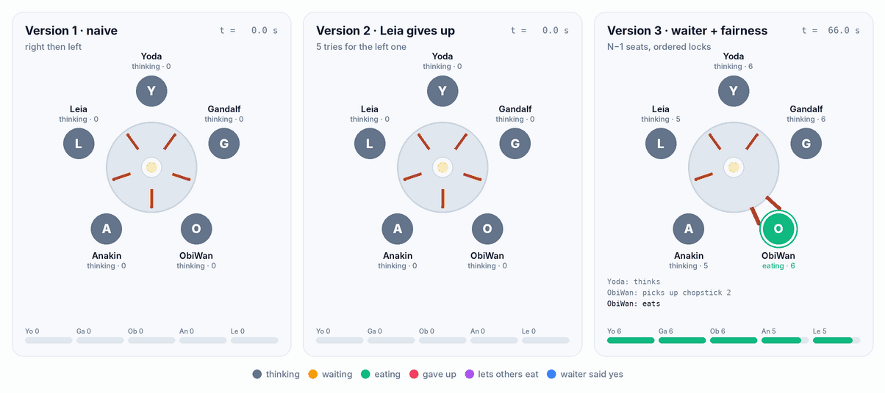
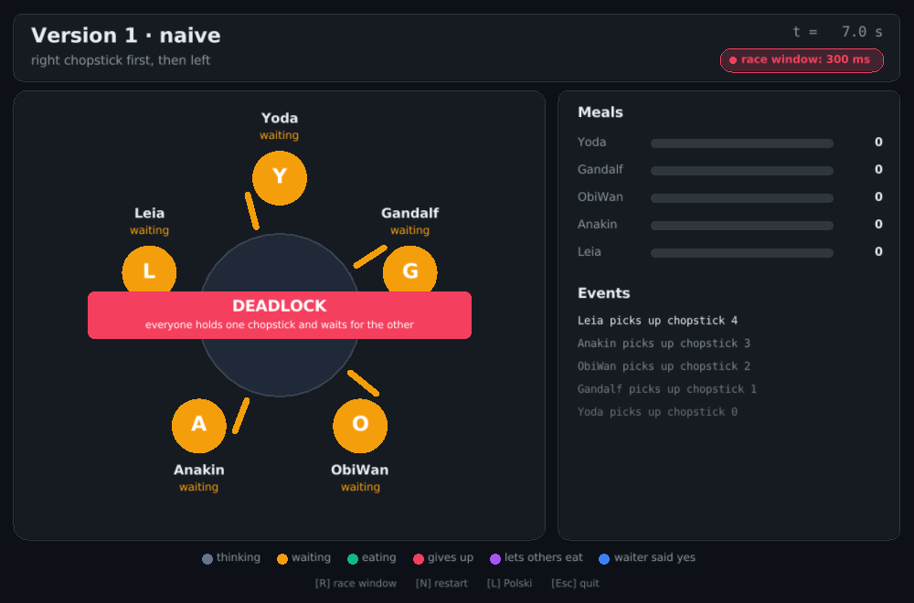
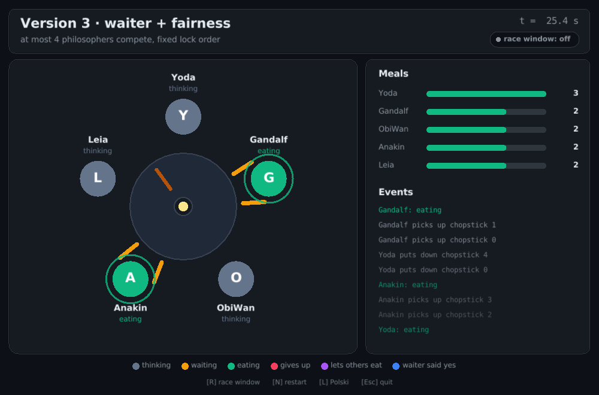
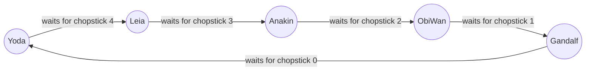
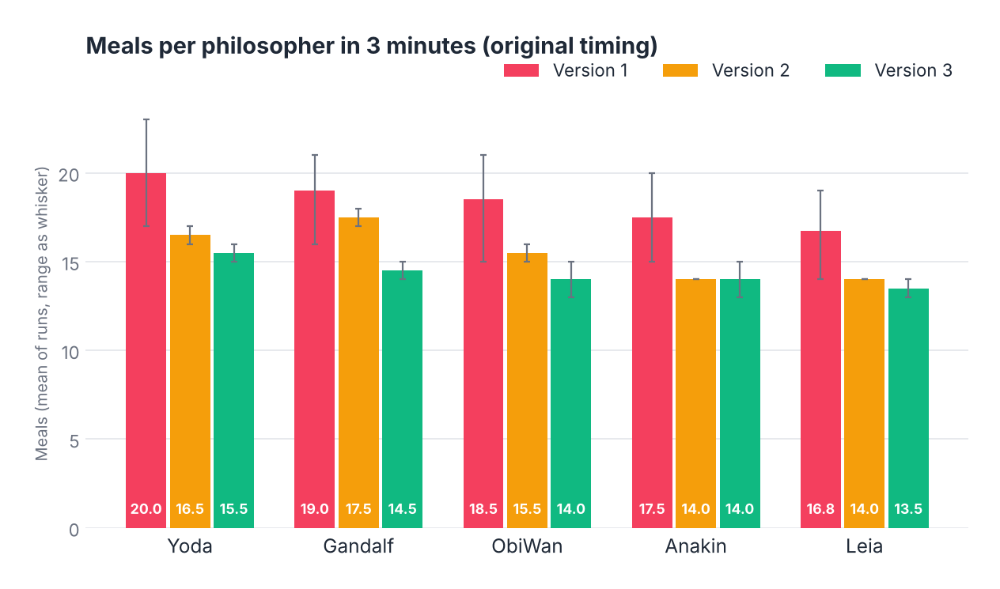
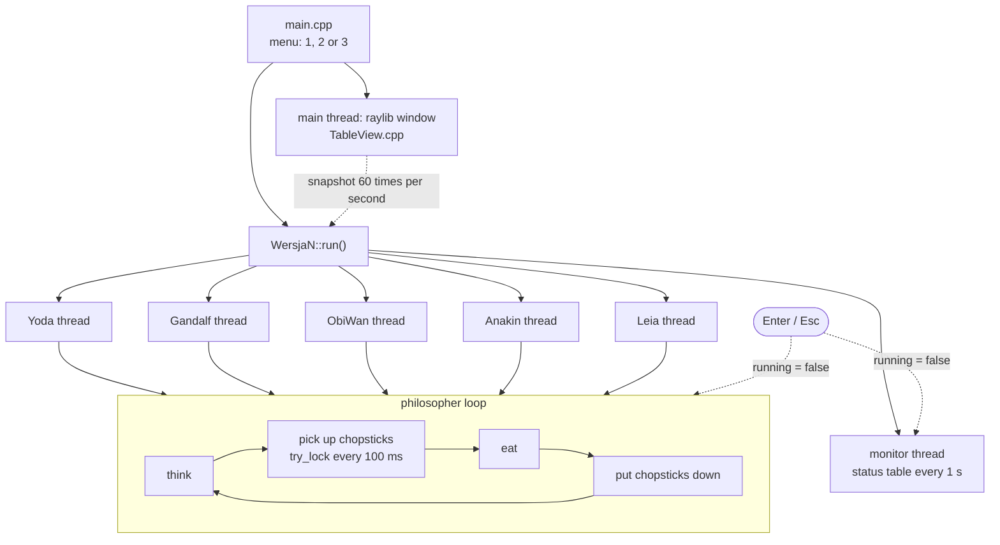

<p align="right">
  <a href="README.md"> <b>English</b></a>
  &nbsp;|&nbsp;
  <a href="README.pl.md"> Polski</a>
</p>

<a href="#see-it-in-action">
  <picture>
    <source media="(prefers-color-scheme: dark)" srcset="docs/banner-en-dark.svg" />
    <source media="(prefers-color-scheme: light)" srcset="docs/banner-en-light.svg" />
    
  </picture>
</a>

<p align="center">
  
  
  
  
  
  
</p>

<p align="center">
  <a href="#see-it-in-action"><b>Demo</b></a> &nbsp;·&nbsp;
  <a href="#live-window"><b>Live window</b></a> &nbsp;·&nbsp;
  <a href="#the-three-versions"><b>Versions</b></a> &nbsp;·&nbsp;
  <a href="#what-the-runs-show"><b>Measurements</b></a> &nbsp;·&nbsp;
  <a href="#how-it-works"><b>How it works</b></a> &nbsp;·&nbsp;
  <a href="#getting-started"><b>Getting started</b></a>
</p>

**Dining Philosophers** is a C++ simulation of Dijkstra's classic concurrency problem, written for the *Operating Systems 2* course at Wrocław University of Science and Technology. Five philosophers (Yoda, Gandalf, ObiWan, Anakin and Leia) sit at a round table, each one a separate `std::thread`. Between every two of them lies one chopstick, guarded by a `std::mutex`, and nobody can eat without holding both neighbouring chopsticks.

The program ships **three strategies** for picking up chopsticks, chosen at start-up. The first one can **deadlock**, the second one breaks the deadlock but lets one philosopher **starve**, and the third one uses a **waiter**, a fixed lock order and a fairness rule so that everyone keeps eating. While the threads run, a **live window** drawn with raylib shows the table: who is thinking, waiting or eating, where every chopstick is, the meal counts and a feed of events. The console keeps printing the original log and a status table every second.

## See it in action

<p align="center">
  <picture>
    <source media="(prefers-color-scheme: dark)" srcset="docs/en/table-dark.gif" />
    <source media="(prefers-color-scheme: light)" srcset="docs/en/table-light.gif" />
    
  </picture>
</p>

<p align="center"><sub>Replayed from real program output, 2× speed. All three runs use a <a href="#provoking-the-deadlock">300 ms pause between the two pickups</a>, which makes the race easy to hit. Version 1 freezes in the first millisecond with every philosopher holding his right chopstick. In version 2 Leia gives up and puts her chopstick back, so the others can go on. Version 3 never blocks, and the purple philosopher is skipping a turn because he has eaten more than the rest.</sub></p>

## Live window

<table>
  <tr>
    <td width="50%"></td>
    <td width="50%"></td>
  </tr>
  <tr>
    <td align="center"><sub>Version 1 after <kbd>R</kbd> and <kbd>N</kbd>: deadlocked within a second</sub></td>
    <td align="center"><sub>Version 3: Yoda lets the others catch up</sub></td>
  </tr>
</table>

After you pick a version in the console, a window opens and follows the simulation in real time. Chopsticks slide to whoever picks them up, an eating philosopher gets a pulsing ring, and a red banner appears when every philosopher holds exactly one chopstick and nobody eats.

| Key | Action |
|---|---|
| <kbd>R</kbd> | Toggles the **race window**: a 300 ms pause between picking up the first and the second chopstick |
| <kbd>N</kbd> | Restarts the simulation from scratch without closing the window |
| <kbd>L</kbd> | Switches the window between Polish and English |
| <kbd>Esc</kbd> | Closes the window and ends the program (so does <kbd>Enter</kbd> in the console) |

To see a deadlock live: run version 1, press <kbd>R</kbd>, then <kbd>N</kbd>.

## Highlights

<table>
  <tr>
    <td width="33%" align="center"><h3>3 / 3</h3><sub>runs of version 1 deadlocked<br/>with a 300 ms race window</sub></td>
    <td width="33%" align="center"><h3>0</h3><sub>deadlocks in versions 2 and 3<br/>under the same conditions</sub></td>
    <td width="33%" align="center"><h3>≤ 2</h3><sub>meals between the best and worst fed<br/>philosopher in version 3</sub></td>
  </tr>
</table>

- **Real threads, real locks.** Every philosopher is a `std::thread`, every chopstick a `std::mutex` with an `std::atomic<int>` that records who holds it, so the monitor can show ownership without taking the lock.
- **Non-blocking pickups, quick shutdown.** Chopsticks are taken with `try_lock()` in a 100 ms polling loop and every long sleep wakes up as soon as the simulation stops, so the program ends within a fraction of a second, even in a deadlock.
- **Window reads, never blocks.** The window runs on the main thread and only reads a snapshot (`snapshot()`) of the atomic chopstick owners, meal counters and statuses, so drawing never slows the philosophers down.
- **Three textbook outcomes in one binary.** Deadlock, starvation and a fair solution share the same table, names and timing, so the only difference between them is the pickup strategy.
- **Live status table.** Once per second a monitor thread prints who holds which chopstick, how many meals each philosopher has had and, in versions 2 and 3, what everyone is doing.

## The three versions

| | Version 1 | Version 2 | Version 3 |
|---|---|---|---|
| **Pickup order** | right, then left | right, then left | lower index first |
| **Waiting for the second chopstick** | forever | forever, except Leia: 5 tries, then she gives up | forever, but with permission from the waiter |
| **Extra mechanism** | none | Leia releases her right chopstick and goes back to thinking | waiter lets at most N−1 = 4 philosophers compete; fairness rule |
| **Deadlock** | possible | broken by Leia | impossible |
| **Starvation** | possible | Leia is the one at risk | prevented by the fairness rule |

### Version 1: deadlock

Every philosopher grabs the chopstick on his right and then waits for the one on his left. If all five grab their right chopstick at the same moment, each one waits for a chopstick his neighbour will never release. This is a textbook **circular wait**, the fourth Coffman condition:



### Version 2: starvation

Leia is the only philosopher allowed to give up. After 5 failed attempts at her left chopstick (about 500 ms) she puts the right one back and returns to thinking. That breaks the circle, so the table can never freeze. The price is paid by Leia: whenever there is contention, she is the one who backs off, while everybody else keeps waiting until they succeed.

### Version 3: waiter and fairness

Three mechanisms work together:

1. **Waiter.** A counting semaphore built from `std::mutex` and `std::condition_variable` lets at most **4 of the 5** philosophers try to pick up chopsticks at once. With one seat empty, at least one philosopher can always get both chopsticks.
2. **Lock ordering.** Everyone picks up the **lower-numbered chopstick first**. For Yoda that means chopstick 0 before 4, the reverse of his neighbours' direction, which alone rules out a circular wait.
3. **Fairness rule.** Before trying to eat, a philosopher checks the meal counters. If he has eaten more than `min + 1`, he waits 500 ms and lets the others catch up.

## What the runs show

The numbers below come from runs with the default timing and the race window off: version 1 four times, versions 2 and 3 twice each, 3 minutes per run.

<p align="center">
  <picture>
    <source media="(prefers-color-scheme: dark)" srcset="docs/en/meals-dark.png" />
    <source media="(prefers-color-scheme: light)" srcset="docs/en/meals-light.png" />
    
  </picture>
</p>

| | Version 1 | Version 2 | Version 3 |
|---|---|---|---|
| Deadlocks | 0 of 4 runs | 0 of 2 runs | 0 of 2 runs |
| Meals in total (mean) | 91.8 | 77.5 | 71.5 |
| Best vs. worst fed (mean) | 20.0 vs. 16.8 | 17.5 vs. 14.0 | 15.5 vs. 13.5 |
| Leia gave up | n/a | 4 times per run | n/a |
| Fairness pauses | n/a | n/a | about 127 per run |

A few things are worth noticing:

- **Version 1 did not deadlock in 12 minutes of running.** The hazard is real, but with these timings it is rare. Yoda's thread starts a fraction of a millisecond ahead and grabs both chopsticks before the others are running, and the per-philosopher delay of `id × 300 ms` helps keep the five out of step.
- **Higher ids eat less in every version.** That same `id × 300 ms` bias makes Anakin and Leia think and eat longer, so they get fewer meals even in version 1.
- **Version 3 trades throughput for fairness.** It has the smallest gap between philosophers but also the fewest meals, because fairness pauses and the waiter leave chopsticks unused at times.

### Provoking the deadlock

To make the race visible, every version can pause for 300 ms between picking up the first and the second chopstick. In the window this is the <kbd>R</kbd> key, and <kbd>N</kbd> restarts the run so the pause applies from the very first pickup:

```cpp
if (int pause = racePauseMs.load(); pause > 0) {
    sleepWhileRunning(pause);  // race window, off by default
}
```

With the pause active from the start, the difference between the strategies is immediate (3 runs per version, 90 s each):

| | Version 1 | Version 2 | Version 3 |
|---|---|---|---|
| Deadlocks | **3 of 3**, all at t ≈ 0 s | 0 of 3 | 0 of 3 |
| Meals per run | 0 | 35 to 38 | 33 to 36 |
| Gap within a run | n/a | 2 to 3 meals, Leia last or tied for last | at most 1 meal |

This is the run replayed in the [animation above](#see-it-in-action).

## How it works



| Piece | Where | Role |
|---|---|---|
| `running` | `main.cpp` | global `std::atomic<bool>`, set to `false` on Enter or when the window closes |
| `racePauseMs` | `main.cpp` | race window in milliseconds, toggled with <kbd>R</kbd> (0 = off) |
| `snapshot()` | each `WersjaN.cpp` | copies chopstick owners, meals and statuses for the window |
| `runTableView()` | `TableView.cpp` | the raylib window: drawing, events, keys |
| `sleepWhileRunning()` | `Czekanie.h` | sleeps in 50 ms steps and wakes up as soon as `running` turns `false` |
| `Chopstick` | each `WersjaN.h` | `std::mutex` plus `std::atomic<int> holder` (−1 when free) |
| `printMutex` | each `WersjaN.h` | keeps lines from different threads from interleaving |
| `mealsEaten` | each `WersjaN.h` | `std::vector<std::atomic<int>>`, one counter per philosopher |
| `Waiter` | `Wersja3.h` | counting semaphore on `std::mutex` and `std::condition_variable` |
| `randomTime()` | each `WersjaN.cpp` | think and eat time: random range plus `id × 300 ms` |

Think and eat times are random: eating takes 1 to 4 s, thinking 1 to 4 s before a meal (versions 2 and 3) and 2 to 5 s after it, each plus the per-philosopher bias.

## Getting started

<p align="center">
  
</p>

The window uses [raylib](https://www.raylib.com/) 5.5. You do not install it yourself: CMake downloads and builds it on the first configure, which needs Git and an internet connection once.

**CLion:** open the folder, let CMake load the project and run the `SO2_Projekt_1` target.

**CMake from the command line:**

```bash
cmake -S . -B build
cmake --build build
./build/SO2_Projekt_1
```

Pick a version (`1`, `2` or `3`) in the console. The window opens next to it, and both the console log and the window run until you press <kbd>Esc</kbd> in the window or <kbd>Enter</kbd> in the console. Version 3 also prints a meal summary at the end. The program's console messages are in Polish.

On Linux raylib needs the X11 and OpenGL development packages (on Ubuntu: `libx11-dev libxrandr-dev libxinerama-dev libxcursor-dev libxi-dev libgl1-mesa-dev`). Without a display the program says so and runs in the console only.

## Project structure

```
.
├── main.cpp            # Menu, global flags, starts the chosen version and the window
├── Wersja1.h / .cpp    # Version 1: right then left, may deadlock
├── Wersja2.h / .cpp    # Version 2: Leia gives up after 5 tries, may starve
├── Wersja3.h / .cpp    # Version 3: waiter, ordered locks, fairness rule
├── TableView.h / .cpp  # Live window (raylib)
├── Czekanie.h          # Sleep that wakes up when the simulation stops
├── CMakeLists.txt      # Build configuration, fetches raylib
├── README.md           # English README
├── README.pl.md        # Polish README
└── docs/               # README visuals (EN / PL, light / dark)
```

---

<p align="center">
  <sub>Wrocław University of Science and Technology · Operating Systems 2 · Grzegorz Sienkiewicz</sub>
</p>
