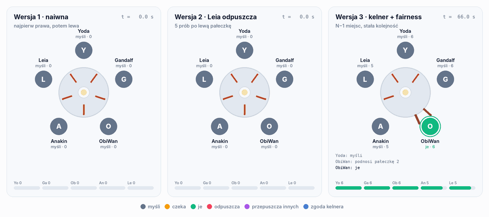
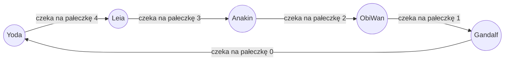
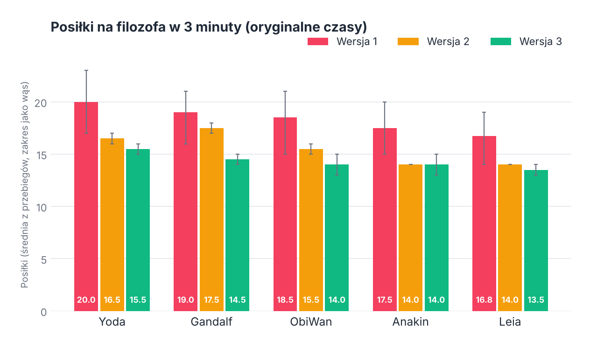
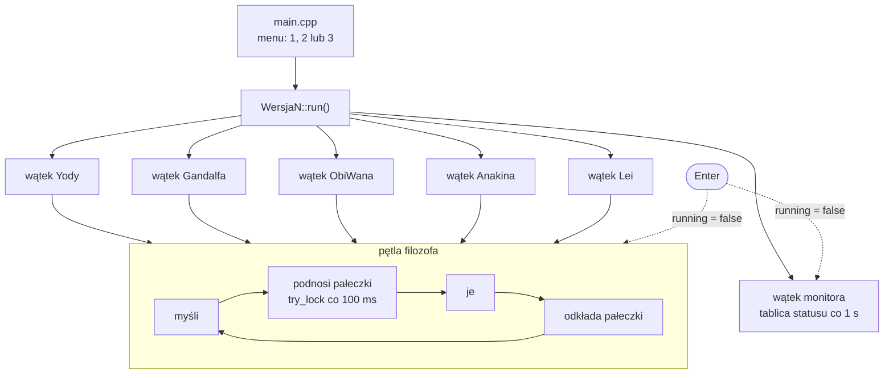

<p align="right">
  <a href="README.md"> English</a>
  &nbsp;|&nbsp;
  <a href="README.pl.md"> <b>Polski</b></a>
</p>

<a href="#zobacz-w-akcji">
  <picture>
    <source media="(prefers-color-scheme: dark)" srcset="docs/banner-pl-dark.svg" />
    <source media="(prefers-color-scheme: light)" srcset="docs/banner-pl-light.svg" />
    
  </picture>
</a>

<p align="center">
  
  
  
  
  
</p>

<p align="center">
  <a href="#zobacz-w-akcji"><b>Demo</b></a> &nbsp;·&nbsp;
  <a href="#trzy-wersje"><b>Wersje</b></a> &nbsp;·&nbsp;
  <a href="#co-pokazały-pomiary"><b>Pomiary</b></a> &nbsp;·&nbsp;
  <a href="#jak-to-działa"><b>Jak to działa</b></a> &nbsp;·&nbsp;
  <a href="#uruchomienie"><b>Uruchomienie</b></a>
</p>

**Problem jedzących filozofów** to symulacja klasycznego problemu współbieżności Dijkstry w C++, napisana na przedmiot *Systemy Operacyjne 2* na Politechnice Wrocławskiej. Pięciu filozofów (Yoda, Gandalf, ObiWan, Anakin i Leia) siedzi przy okrągłym stole, a każdy z nich to osobny `std::thread`. Między każdymi dwoma leży jedna pałeczka chroniona przez `std::mutex` i nikt nie może jeść bez obu sąsiednich pałeczek.

Program zawiera **trzy strategie** podnoszenia pałeczek, wybierane przy starcie. Pierwsza może doprowadzić do **zakleszczenia**, druga przerywa zakleszczenie, ale naraża jednego filozofa na **zagłodzenie**, a trzecia używa **kelnera**, stałej kolejności blokad i reguły sprawiedliwości, dzięki czemu wszyscy jedzą na zmianę. Osobny wątek monitora co sekundę drukuje tablicę statusu.

## Zobacz w akcji

<p align="center">
  <picture>
    <source media="(prefers-color-scheme: dark)" srcset="docs/pl/table-dark.gif" />
    <source media="(prefers-color-scheme: light)" srcset="docs/pl/table-light.gif" />
    
  </picture>
</p>

<p align="center"><sub>Odtworzone z prawdziwego wyjścia programu, prędkość 2×. Wszystkie trzy przebiegi mają <a href="#wywołanie-zakleszczenia">300 ms przerwy między podniesieniem pierwszej i drugiej pałeczki</a>, co ułatwia trafienie w wyścig. Wersja 1 staje w pierwszej milisekundzie, a każdy filozof trzyma swoją prawą pałeczkę. W wersji 2 Leia odpuszcza i odkłada pałeczkę, więc reszta może jeść dalej. Wersja 3 nigdy się nie blokuje, a fioletowy filozof opuszcza kolejkę, bo zjadł więcej niż pozostali.</sub></p>

## Kluczowe wyniki

<table>
  <tr>
    <td width="33%" align="center"><h3>3 / 3</h3><sub>przebiegi wersji 1 zakleszczone<br/>przy oknie wyścigu 300 ms</sub></td>
    <td width="33%" align="center"><h3>0</h3><sub>zakleszczeń w wersjach 2 i 3<br/>w tych samych warunkach</sub></td>
    <td width="33%" align="center"><h3>≤ 2</h3><sub>posiłki różnicy między najlepiej a najgorzej<br/>najedzonym filozofem w wersji 3</sub></td>
  </tr>
</table>

- **Prawdziwe wątki i blokady.** Każdy filozof to `std::thread`, każda pałeczka to `std::mutex` z `std::atomic<int>` zapamiętującym właściciela, więc monitor pokazuje stan bez zakładania blokady.
- **Nieblokujące podnoszenie.** Pałeczki są brane przez `try_lock()` w pętli co 100 ms, więc każdy wątek zauważa `running == false` i symulacja zawsze kończy się czysto po Enterze, nawet w zakleszczeniu.
- **Trzy podręcznikowe przypadki w jednym programie.** Zakleszczenie, zagłodzenie i rozwiązanie sprawiedliwe mają ten sam stół, imiona i czasy, więc różnią się wyłącznie strategią podnoszenia pałeczek.
- **Tablica statusu na żywo.** Co sekundę wątek monitora drukuje, kto trzyma którą pałeczkę, ile kto zjadł posiłków, a w wersjach 2 i 3 także co kto robi.

## Trzy wersje

| | Wersja 1 | Wersja 2 | Wersja 3 |
|---|---|---|---|
| **Kolejność podnoszenia** | prawa, potem lewa | prawa, potem lewa | najpierw niższy indeks |
| **Czekanie na drugą pałeczkę** | bez końca | bez końca, poza Leią: 5 prób i rezygnuje | bez końca, ale za zgodą kelnera |
| **Dodatkowy mechanizm** | brak | Leia oddaje prawą pałeczkę i wraca do myślenia | kelner wpuszcza najwyżej N−1 = 4 filozofów; reguła sprawiedliwości |
| **Zakleszczenie** | możliwe | przerywa je Leia | niemożliwe |
| **Zagłodzenie** | możliwe | zagrożona jest Leia | blokuje je reguła sprawiedliwości |

### Wersja 1: zakleszczenie

Każdy filozof bierze pałeczkę po prawej, a potem czeka na tę po lewej. Jeśli wszyscy pięciu złapią prawą pałeczkę w tej samej chwili, każdy czeka na pałeczkę, której sąsiad nigdy nie odda. To podręcznikowe **cykliczne oczekiwanie**, czwarty warunek Coffmana:



### Wersja 2: zagłodzenie

Tylko Leia może zrezygnować. Po 5 nieudanych próbach podniesienia lewej pałeczki (około 500 ms) odkłada prawą i wraca do myślenia. To przerywa cykl, więc stół nigdy nie zamarza. Płaci za to Leia: przy każdej rywalizacji to ona ustępuje, a pozostali czekają do skutku.

### Wersja 3: kelner i sprawiedliwość

Działają tu trzy mechanizmy naraz:

1. **Kelner.** Semafor zliczający zbudowany na `std::mutex` i `std::condition_variable` pozwala sięgać po pałeczki najwyżej **4 z 5** filozofów jednocześnie. Przy jednym wolnym miejscu co najmniej jeden filozof zawsze zdobędzie obie pałeczki.
2. **Kolejność blokad.** Każdy podnosi najpierw **pałeczkę o niższym numerze**. Dla Yody oznacza to pałeczkę 0 przed 4, czyli odwrotny kierunek niż u sąsiadów, co samo w sobie wyklucza cykliczne oczekiwanie.
3. **Reguła sprawiedliwości.** Przed próbą jedzenia filozof sprawdza liczniki posiłków. Jeśli zjadł więcej niż `min + 1`, czeka 500 ms i pozwala innym nadrobić.

## Co pokazały pomiary

Poniższe liczby pochodzą z uruchomień niezmienionego programu: wersja 1 cztery razy, wersje 2 i 3 po dwa razy, po 3 minuty każde.

<p align="center">
  <picture>
    <source media="(prefers-color-scheme: dark)" srcset="docs/pl/meals-dark.png" />
    <source media="(prefers-color-scheme: light)" srcset="docs/pl/meals-light.png" />
    
  </picture>
</p>

| | Wersja 1 | Wersja 2 | Wersja 3 |
|---|---|---|---|
| Zakleszczenia | 0 z 4 przebiegów | 0 z 2 przebiegów | 0 z 2 przebiegów |
| Posiłki łącznie (średnio) | 91,8 | 77,5 | 71,5 |
| Najlepiej vs. najgorzej najedzony (średnio) | 20,0 vs. 16,8 | 17,5 vs. 14,0 | 15,5 vs. 13,5 |
| Rezygnacje Lei | nie dotyczy | 4 na przebieg | nie dotyczy |
| Pauzy sprawiedliwości | nie dotyczy | nie dotyczy | około 127 na przebieg |

Warto zwrócić uwagę na kilka rzeczy:

- **Wersja 1 nie zakleszczyła się przez 12 minut działania.** Zagrożenie jest prawdziwe, ale przy tych czasach rzadkie. Wątek Yody startuje ułamek milisekundy wcześniej i bierze obie pałeczki, zanim reszta zdąży ruszyć, a opóźnienie `id × 300 ms` pomaga utrzymać filozofów w różnych fazach.
- **Wyższe id jedzą mniej w każdej wersji.** To samo opóźnienie `id × 300 ms` sprawia, że Anakin i Leia dłużej myślą i jedzą, więc mają mniej posiłków nawet w wersji 1.
- **Wersja 3 płaci przepustowością za sprawiedliwość.** Ma najmniejszą różnicę między filozofami, ale też najmniej posiłków, bo pauzy sprawiedliwości i kelner czasem zostawiają pałeczki nieużywane.

### Wywołanie zakleszczenia

Żeby wyścig był widoczny, wersja demonstracyjna dodaje 300 ms przerwy między podniesieniem pierwszej i drugiej pałeczki w każdej wersji:

```cpp
this_thread::sleep_for(chrono::milliseconds(300)); // tylko w wersji demo, nie ma tego w repozytorium
```

Przy tak otwartym oknie różnica między strategiami jest natychmiastowa (3 przebiegi na wersję, po 90 s):

| | Wersja 1 | Wersja 2 | Wersja 3 |
|---|---|---|---|
| Zakleszczenia | **3 z 3**, wszystkie przy t ≈ 0 s | 0 z 3 | 0 z 3 |
| Posiłki na przebieg | 0 | od 35 do 38 | od 33 do 36 |
| Różnica w przebiegu | nie dotyczy | 2 do 3 posiłków, Leia ostatnia lub ex aequo ostatnia | najwyżej 1 posiłek |

Ten właśnie przebieg jest odtworzony na [animacji powyżej](#zobacz-w-akcji).

## Jak to działa



| Element | Gdzie | Rola |
|---|---|---|
| `running` | `main.cpp` | globalny `std::atomic<bool>`, po Enterze ustawiany na `false`, żeby zatrzymać wszystkie wątki |
| `Chopstick` | każdy `WersjaN.h` | `std::mutex` plus `std::atomic<int> holder` (−1 gdy wolna) |
| `printMutex` | każdy `WersjaN.h` | pilnuje, żeby linie z różnych wątków się nie przeplatały |
| `mealsEaten` | każdy `WersjaN.h` | `std::vector<std::atomic<int>>`, jeden licznik na filozofa |
| `Waiter` | `Wersja3.h` | semafor zliczający na `std::mutex` i `std::condition_variable` |
| `randomTime()` | każdy `WersjaN.cpp` | czas myślenia i jedzenia: losowy przedział plus `id × 300 ms` |

Czasy są losowe: jedzenie trwa od 1 do 4 s, myślenie od 1 do 4 s przed posiłkiem (wersje 2 i 3) i od 2 do 5 s po nim, za każdym razem z dodatkiem zależnym od filozofa.

## Uruchomienie

<p align="center">
  
</p>

**CLion:** otwórz folder i uruchom target `SO2_Projekt_1`.

**CMake:**

```bash
cmake -S . -B build
cmake --build build
./build/SO2_Projekt_1
```

**Bez CMake** (dowolny kompilator z C++20):

```bash
g++ -std=c++20 -pthread main.cpp Wersja1.cpp Wersja2.cpp Wersja3.cpp -o philosophers
./philosophers
```

Wybierz wersję (`1`, `2` lub `3`), a **Enter** kończy symulację. Wersja 3 na końcu drukuje też podsumowanie posiłków.

> `CMakeLists.txt` ustawia `CMAKE_CXX_STANDARD 26`. Sam kod wymaga tylko C++20, więc ze starszym kompilatorem można tę wartość obniżyć.

## Struktura projektu

```
.
├── main.cpp          # Menu, globalna flaga running, uruchamia wybraną wersję
├── Wersja1.h / .cpp  # Wersja 1: prawa, potem lewa, możliwe zakleszczenie
├── Wersja2.h / .cpp  # Wersja 2: Leia rezygnuje po 5 próbach, możliwe zagłodzenie
├── Wersja3.h / .cpp  # Wersja 3: kelner, stała kolejność blokad, reguła sprawiedliwości
├── CMakeLists.txt    # Konfiguracja budowania
├── README.md         # README po angielsku
├── README.pl.md      # README po polsku
└── docs/             # Grafiki do README (EN / PL, jasne / ciemne)
```

---

<p align="center">
  <sub>Politechnika Wrocławska · Systemy Operacyjne 2 · Grzegorz Sienkiewicz</sub>
</p>
